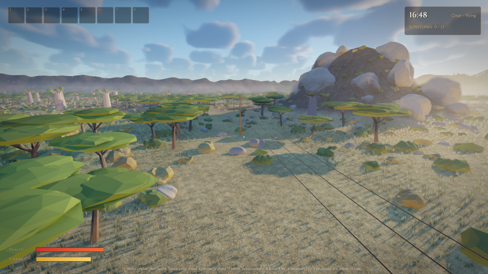
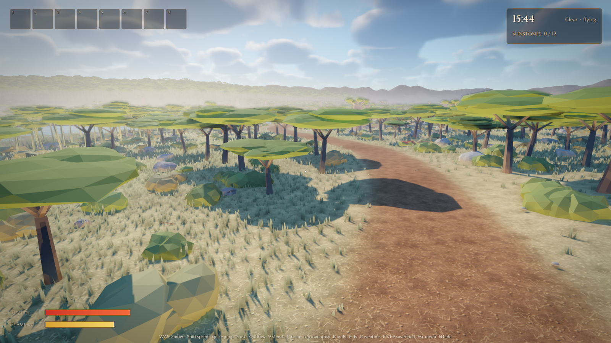

# World as data: terrain, biomes, foliage, grass, weather (Phase W)

Goal: everything that makes up a level can be edited per scene in the editor:
terrain shape, biomes, what grows where, weather and time of day. A new scene
starts empty; you add a Terrain, stamps, biomes and vegetation from the
Create menu.

## Stages

| Stage | Contents | Status |
|---|---|---|
| W1 | Weather, DayNightCycle, Water as registered scene objects (effects module) | ✅ |
| W2 | `ve::Terrain`: procedural heightfield (seed, noise layers, border mountains), chunk meshes, heightfield collider, `TerrainStamp` children (flatten / raise / lower, movable with the gizmo), rebuild when edited | ✅ |
| W3 | Biomes as data on the Terrain: ground colours, where they occur (height / slope / noise patches), biome stamps; per-point biome weights blended at borders | ✅ (rules + stamp painting; vegetation still reads them from code) |
| W4 | Data-driven vegetation: `Foliage` + `FoliageType` layers, `GrassLayer`, `FoliageExclusion` (meshes from glTF with manual LOD chains, or a code-registered `MeshLibrary` entry; per-biome density; spacing, scale, colliders...). GrassPass LOD chain (near mesh -> mid mesh -> cards). Regenerates when the terrain changes | ✅ |
| W5 | Savanna moved onto all of it: terrain + biomes + vegetation in `scenes/savanna.json`, procedural tree meshes registered in the MeshLibrary | ✅ |

## Notes from W1-W3
- **Savanna's world is now data.** `scenes/savanna.json` holds the Terrain
  with four biomes (Savannah, Swamp, Camp, Rocky) and four stamps (Swamp basin
  with noisy pools, Kopje, Small kopje, Camp clearing), plus Water, Weather and
  DayNightCycle. The old `sandbox/src/Terrain.*` is gone.
- **Terrain queries are snapshot based.** `Terrain::data()` returns an
  immutable `TerrainData`; worker threads keep their copy alive. Game code
  should look the terrain up (`Terrain::find(scene)`) rather than holding a
  reference: the editor can replace scene objects (Open scene).
- **Play/Stop restores in place:** existing objects get their saved state
  re-applied, deleted ones are re-created and new ones removed.

## Notes from W4-W5
- **Vegetation is scene data.** Savanna's `scenes/savanna.json` now holds a
  `Foliage` object with six `FoliageType` children (Baobabs, Acacias, Fever
  trees, Boulders, Rocks, Bushes), `GrassLayer`s for grass and reeds, and
  `FoliageExclusion`s on the camp clearing and the huts. Only the procedural
  meshes stay in code (`registerPropMeshes()` -> `ve::MeshLibrary`).
  Placement matches the old code rules closely (9466 vs 9459 instances, same
  colliders).
- **Everything follows the terrain.** Foliage and grass rebuild (throttled)
  when the terrain's `version()` changes, when their settings change, or when
  an exclusion moves. The Terrain itself now rebuilds only when its fields,
  position or stamps actually change (Play/Stop no longer rebuilds it).
- **Headless runs for tests.** `VE_HEADLESS=1` renders offscreen with a hidden
  window; `VE_CAPTURE=out.png [VE_CAPTURE_FRAME=N]` saves a frame.
  `SAVANNA_SCENE=path.json` loads another scene file.

## Authoring LOD chains in Blender
Export glTF (`.glb` / `.gltf`, +Y up) with one object per level:

| Object name | Becomes |
|---|---|
| `Grass_LOD0`, `Grass_LOD1`, `Grass_LOD2` | the levels of variant "Grass", nearest first |
| `LOD0`, `LOD1`... | the same, for a file with one variant |
| an empty named `Tree_LOD0` with child meshes | one level; the children are merged |
| `Tree_COL` / `COL` / `UCX_Tree` | collision (its convex hull) for that variant / all variants; not drawn |
| `Rock_A`, `Rock_B` (no LOD names) | one variant each, a single level |

- A level's position is ignored (its rotation and scale are kept), so you can
  lay the levels out side by side in Blender. Blender's `.001` suffixes are
  ignored.
- Separate files work too: `mesh = "grass_lod0.glb; grass_lod1.glb"`.
- **Grass** (`GrassLayer::mesh`): the root at the origin. Each level is scaled
  so LOD0 is 1 unit tall, then the layer's `minHeight..maxHeight` sets the real
  height. The base colour texture's alpha is cut out at `alphaCutoff`, so a card
  level just works. Base colour factors and vertex colours tint the mesh, and
  the vertex height (0..1) is the wind sway weight. Switch distances are
  `lodDistances` (m), dithered over `lodBlend`.
- **Foliage** (`FoliageType::mesh`): real size. `lodMode` is screen size or
  distance, with `lodThresholds`. `impostor` adds a baked octahedral impostor as
  the last level, and `autoLods` simplifies one-level meshes. Both are better
  cooked: put `{"autoLods": 2, "impostor": true}` in `<mesh>.model` and the
  levels and impostor are made by `vecook` (or the first run) and read from
  the cooked model, with no impostor baking at load (docs/03-conventions.md,
  "Models cook too"). `collision`:
  Auto (the `_COL` nodes), a primitive sized by `colliderSize`, or the convex
  hull of LOD0.
- The log says what was found, e.g. `FoliageType 'Plants': 1 variant(s) from
  plant.glb, 3 level(s) + impostor, 1 authored collider(s)`.

## Splines: fences, powerlines, roads

A `Spline` component (scene/Spline.hpp; editing: docs/05-editor.md
"Splines") is the path; what follows it is another component or object on
the same GameObject:

- **`SplineInstancer`** (world/SplineInstancer.hpp; Create > Spline > Fence /
  Powerline): a mesh repeated along the path, as GPU instances with the
  model's LOD chain, impostor and variants (picked at random per item).
  - Items every `spacing` m (`fitEnds` lands them on both ends), or one per
    control point (`atPoints`: poles exactly where you put them).
  - Items are dropped onto the terrain (`followGround`) and stand upright unless
    `tiltWithGround`. Their axes are +X along the path, +Y up, +Z to the right;
    `offset`, `yaw`, `randomYaw`, `scaleRange` and `jitter` vary them.
  - Cables or rails: `cableAttach` lists points in the item's local space;
    each gets a tube from every item to the next. `cableSag` is the sag at
    mid-span as a fraction of the span (0 for rails, about 0.03 for powerlines).
  - `collision` gives each item a static box collider (from LOD0's bounds).
  - Everything rebuilds when the spline, the fields or the terrain change,
    live while you drag points in the editor.
- **`TerrainSpline`** (world/TerrainSpline.hpp; Create > Spline > Road /
  Path): a road, track, path or riverbed. The terrain applies every road after
  its generator, stamps and brush edits, in scene order (later roads win where
  they cross):
  - The ground is made flat across `width` (times each point's width
    factor) and blends back into the land over `falloff`: the embankments.
  - Height: with `followGround` (default) the ground under the road, smoothed
    along it over `smoothing` m, so point heights don't matter; off, the
    spline's own height (ramps, causeways, cuttings). `heightOffset` sinks or
    raises it (a riverbed: negative, with a wide falloff).
  - `biome` paints a terrain biome under it (blending out over `biomeFalloff`).
  - `material` lays a surface mesh over it (UV u across, v along every
    `uvLength` m) for edges sharper than the terrain's 2 m samples.
  - Editing a road re-shapes only the land around it, like a brush stroke:
    sample tiles, LOD meshes, colliders and nearby foliage / grass. Things
    standing on the ground (spline instancers) follow. Navmeshes don't:
    call `NavMeshSurface::rebuild(area)`.
  - The editor draws the road's width and falloff (orange) and any vegetation
    corridor (green) around the selected spline.
- **Keeping vegetation off the line:** `FoliageExclusion` with `spline` on is
  a corridor `width` metres wide (times each point's width factor) along the
  object's spline. `foliage` / `grass` choose what it clears (grass thins out
  over `falloff`). The Fence preset clears trees 3 m wide and keeps the grass;
  the Powerline preset clears a 14 m corridor of trees. Like every exclusion,
  moving it re-places only the vegetation around it.

### Sub-biomes: variations inside a biome

A biome decides the ground and what grows there. A **sub-biome**
(`TerrainSubBiome`, the Terrain's `subBiomes`) varies that inside an area
without replacing the biome: under powerlines it is still savanna, but no
trees grow and the grass is kept short. Define it once on the Terrain:

```json
"subBiomes": [{"name": "Powerline corridor", "foliage": 0, "layers": "Rocks:1, Boulders:1, Bushes:0.3",
               "grass": 1, "grassHeight": 0.45}]
```

- `foliage` multiplies every foliage layer's density inside; `layers` gives
  per-layer factors that win over it (FoliageType object names).
- `grass` / `grassHeight` multiply grass density and height.
- **Laying it:** a `TerrainMask` component names the sub-biome. On an object
  with a Spline it is a corridor `width` wide (the powerline's); without, a
  circle of `radius` (a clearing). Both fade out over `falloff`, scaled by
  `strength`. Several masks can lay the same sub-biome; overlapping
  sub-biomes multiply.
- Foliage and grass `biomes` rules can also name a sub-biome:
  `"Savannah:1, Powerline corridor:-1"` (its weight, 0..1).
- Moving or editing a mask refreshes only the vegetation around it.
- The editor draws a mask's corridor or circle in purple. The Terrain logs a
  mask naming a sub-biome it doesn't define.



This is the overlay half of a terrain workflow: biomes come from rules
(height, slope, noise) and painting; sub-biomes come from areas laid on top.
Rule-driven sub-biomes (by slope, height or distance to water: scree under
cliffs, reeds at shores) would fit the same definitions as another source of
weights.

Savanna: a paddock fence east of the camp (a closed spline, posts and two
rails), a powerline from the south-east to the camp, a dirt road west from
the camp (5 m, painted "Camp" earth, a `materials/dirt_road.material` surface,
trees cleared 14 m wide and grass 7 m) and a footpath north towards the swamp.


The powerline lays the "Powerline corridor" sub-biome (16 m wide): no trees,
a few bushes, rocks kept, grass at 45 % height. The autotest checks the posts,
rails and cables, that the corridor holds no trees (while the land beside it
does), keeps its rocks and halves the grass, that the road is flat across
and painted with no trees, and that moving a footpath point re-shapes only
the land around it.

## Design notes

**Terrain.**
- `ve::Terrain` is a GameObject class (registered).
- Height = base noise (fbm) + secondary hills + border mountains + stamps,
  applied in order:
  - Flatten: blend towards a height.
  - Raise: dome or ridged hill.
  - Lower: basin down to a height, with noisy pools.
- Each stamp has a radius and a falloff, and can force a biome.
- Stamps are `TerrainStamp` components on any GameObject, usually children of
  the terrain, so you place them with the gizmo.
- The terrain watches its parameters and its stamps' transforms, and rebuilds
  when they change: a changed field rebuilds everything, a moved or edited
  stamp, road or mask only the land around it (old and new place). Dependent
  systems (foliage, grass) see the terrain's `version()` change and regenerate
  (just that area for a local change).
- **Nothing rebuilds while you drag.** While the editor drags something (gizmo,
  spline point, an inspector field), terrain, foliage and grass wait, and
  rebuild once it's released and stayed released for
  `Engine::editSettleSeconds` (0.35 s): grabbing it again in that time doesn't
  start clearing foliage. Code asks `Engine::worldEditsHeld()`; tools other
  than the editor call `Engine::setInteractiveEdit(bool)`. Terrain brushing
  stays live.
- **Collider tiles rebuild in the background.** A changed tile's heights are
  sampled on the job pool and its old body stays until the new one is ready;
  only a missing tile under the camera, a character or a dynamic body is made
  on the spot.
- **Any size.** Samples are generated per 64-cell tile when something needs
  them; the visible ground is a quadtree LOD and colliders exist only near the
  camera, characters and dynamic bodies (see 01-architecture §5.9). Savanna is
  4 km wide (`size` 4096, `cellSize` 2: 2049² samples).
- **Regions.** A Raise stamp with `height` 0 and a large `biomeRadius` paints a
  whole region's biome; its ridged noise (`ridgeAmount`, `ridgeFrequency`)
  shapes it: Savanna's desert uses ~80 m ridges for dunes, its jungle broad
  ridges for rolling hills.

**Biomes.**
- A biome has a name, a ground colour (+ variation colour), and rules: height
  range, max slope, noise frequency/coverage (patches), priority.
- Weight for a point = the strongest matching rule, softened at the edges, or a
  stamp forcing it. Biome 0 is the default (fills the rest).
- Steep slopes show a "rock" colour regardless of biome; near the water line
  the ground goes to mud.
- **Ground materials (splat layers).** A biome can have a tiling `material`
  instead of (or on top of) its colours, and the terrain an optional
  `rockMaterial` for steep slopes and the border mountains. Every map is
  optional:

  ```json
  "material": {"albedo": "textures/ground/sand_albedo.png",
               "normal": "textures/ground/sand_normal.png",
               "roughness": "textures/ground/sand_roughness.png",
               "ao": "textures/ground/sand_ao.png",
               "size": 4.0, "tint": [1, 1, 1], "normalStrength": 1.0, "roughnessValue": 0.9}
  ```

  `size` is metres per repeat. Normal maps use the OpenGL convention (green =
  up). Without an albedo the layer keeps the biome colour but still adds the
  normal / roughness / AO detail. The albedo's alpha, if present, is a height:
  where layers meet, the higher texels win (stones poke through sand) instead
  of a soft cross-fade. Normal, roughness and AO are packed into one texture
  on load, so a layer costs two texture fetches.
- `biomeColor` (0..1) recolours a layer with the biome's own colour (with its
  noise and patches), keeping only the texture's light/dark detail: the
  palette stays art-directable, the texture adds pebbles, straw, cracks.
  Savanna's savannah soil uses it so the ground stays golden next to the grass.
- Each terrain vertex blends up to three layers (the three that weigh most in
  its LOD node); whatever weight is left (untextured biomes, mud) shows the
  vertex colour. Rock is projected from three sides, so cliffs don't stretch.
- Distance tiling: beyond ~6 repeats a second copy of each texture, rotated
  and 3.7× larger, is blended in so the repeats stop lining up, and a large
  scale noise (`detailTexture` at `detailScales.y`) varies the brightness
  (empty by default: a neutral grey, no variation; Savanna's scene sets
  `textures/ground_detail.png`).
- Savanna: soil (savannah, camp), sand (desert), leaf litter (jungle) and rock
  (rocky, cliffs); the swamp keeps its colours. The textures come from
  `tools/generate_assets.py`.
- Hand edits: the editor's sculpt and paint brushes (docs/05-editor.md, E4)
  add a height offset and a painted biome on top of all of the above.
- `Terrain::biomeWeights(x, z)` gives the per-biome weights to anyone
  (foliage, grass, gameplay).

**Biome files, and biomes that own their vegetation.**
- A biome can live in its own asset file, so several scenes (and terrains)
  share it. The terrain's `biomes` list then holds a reference instead of the
  whole biome: `"biomes": [{"asset": "biomes/meadow.biome"}, {"asset": "biomes/rocky.biome"}]`.
  Inline biomes still work (older scenes, quick tests), and a list can mix both.
- A `.biome` file is JSON with the same keys as an inline biome (`name`,
  `color`, `coverage`, `material`...; a missing `name` becomes the file name),
  plus what grows there:

  ```json
  {"version": 1, "name": "Rocky", "color": [0.42, 0.38, 0.32], "coverage": 0.35,
   "foliage": [{"type": "foliage/rocks.foliage", "density": 1.0}],
   "grass":   [{"type": "grass/meadow.grass",   "density": 0.25}]}
  ```

- A `.foliage` file holds `FoliageType` fields, a `.grass` file `GrassLayer`
  fields (missing keys keep the defaults). Their `biomes` field is ignored:
  the biomes that list a file decide where it grows.
- A `BiomeVegetation` object in the scene grows the lists: one foliage layer
  per `.foliage` file and one `GrassLayer` per `.grass` file. A file's density
  at a point = Σ over biomes (that biome's weight there × the density it gives
  the file), so a file listed by several biomes is one layer whose density
  blends across their borders (no double planting). Layer names are the file
  names (`rocks`): that is what `avoid` refers to, and layers are ordered by
  first mention. What it creates are code objects (not saved in the scene).
  Its own fields are the `Foliage` settings (`edgeMargin`, `cellSize`,
  `colliderFocus`, `preload`). Hand-made `Foliage` / `GrassLayer` objects keep
  working alongside it.
- **Live editing.** `ve::DataAssets` (`ve/assets/DataAsset.hpp`) caches these
  files. A file changed on disk is reloaded within half a second; the terrain
  re-reads its biome files and rebuilds, and `BiomeVegetation` re-applies the
  plant files (foliage and grass then rebuild as after any settings change).
- **In the editor:** selecting the terrain shows a **Biomes** list (order,
  add a biome file, create one, move an inline biome to a file, remove; inline
  biomes are edited in place, with undo). **Edit** (or the **Assets** menu)
  opens a file in the asset window: changes apply live and are marked unsaved
  (`*`) until **Save** writes the file (to the source assets folder in a
  development build); **Revert** drops them. Asset edits have no undo of their
  own; Revert is the way back. Unsaved edits win over changes on disk.

**Vegetation** (`ve/world/Vegetation.hpp`, `LodModel.hpp`).
- Foliage layers are `FoliageType` components on child objects of a `Foliage`
  object (the object name is the layer name, used by `avoid = "Acacias:2.5"`).
  Each `GrassLayer` object is one GPU grass field. They reference meshes by:
  - a glTF path. Nodes named `*_LOD0`, `*_LOD1`... (or `LOD0`...) form the LOD
    chain; otherwise the first mesh node is used.
  - or a `MeshLibrary` name, for meshes a game generates in code (Savanna's
    procedural trees).
- Density per biome: `biomes = "Savannah:1, Swamp:0.2"`. Negative values
  push a layer out of a biome, and `*` is a constant (weights add up to 1), so
  `"*:1, Rocky:-1.2, Swamp:-0.8"` means everywhere except rocks and swamp.
  `biomeThreshold > 0` turns the density into all-or-nothing.
- Optional impostor as the last LOD.
- Alpha-masked glTF materials become cutout materials automatically, so grass
  cards just work.
- `FoliageExclusion` on any object keeps vegetation out: the camp, inside
  the huts, under building pieces.
  - **Shape:** a circle (`radius`) or a box (`box`, `size`, turning with the
    object's yaw), with an `offset`.
  - **Grass falloff:** grass thins out over `falloff` past the edge.
  - **What it affects:** `foliage` and `grass` each switch on separately.
  - **Changing it while playing** (a building placed or removed, an
    exclusion moved in the editor) doesn't rebuild everything.
    `Foliage` re-places only the cells around the change
    (`FoliageSystem::setExclusions`), keeping chopped / picked states;
    `GrassLayer` re-bakes its window in the background, as it does after
    terrain brush edits. Ghost previews (`PlacementGhost`) are ignored.
