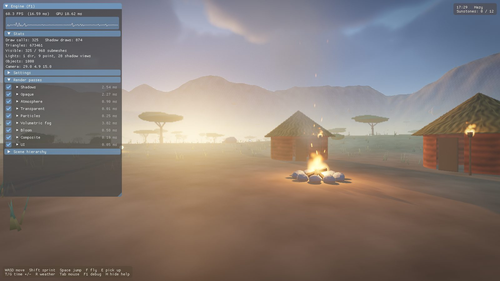
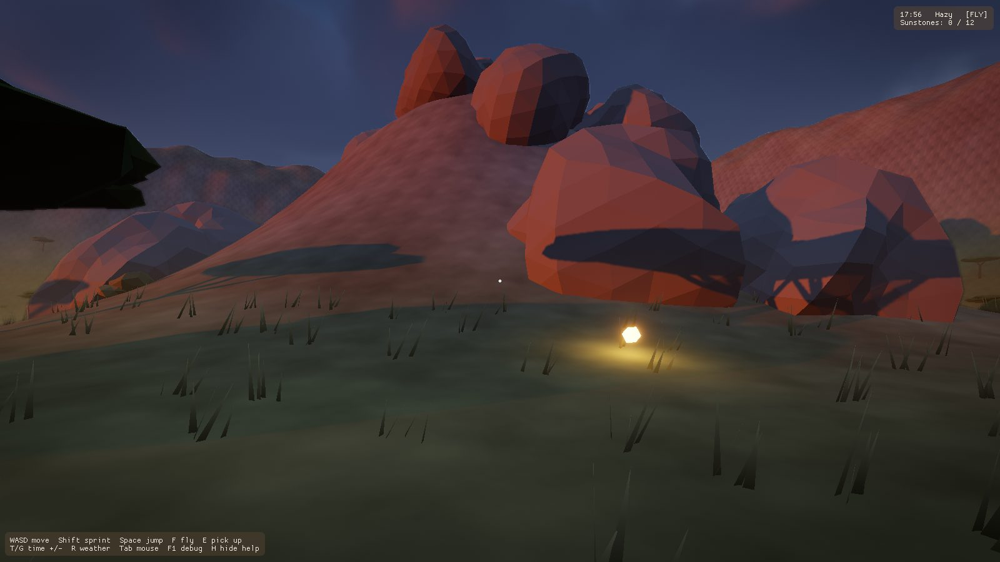
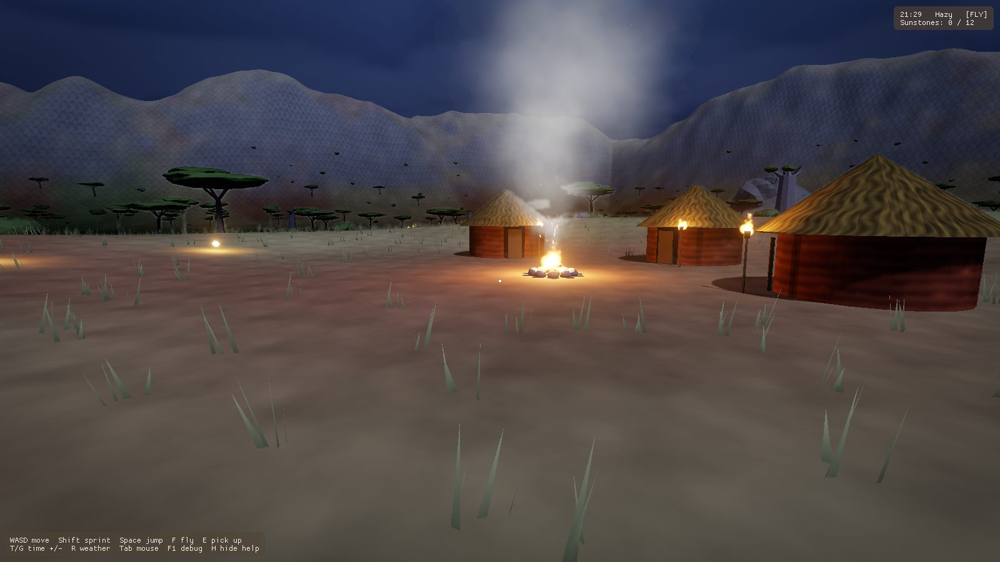
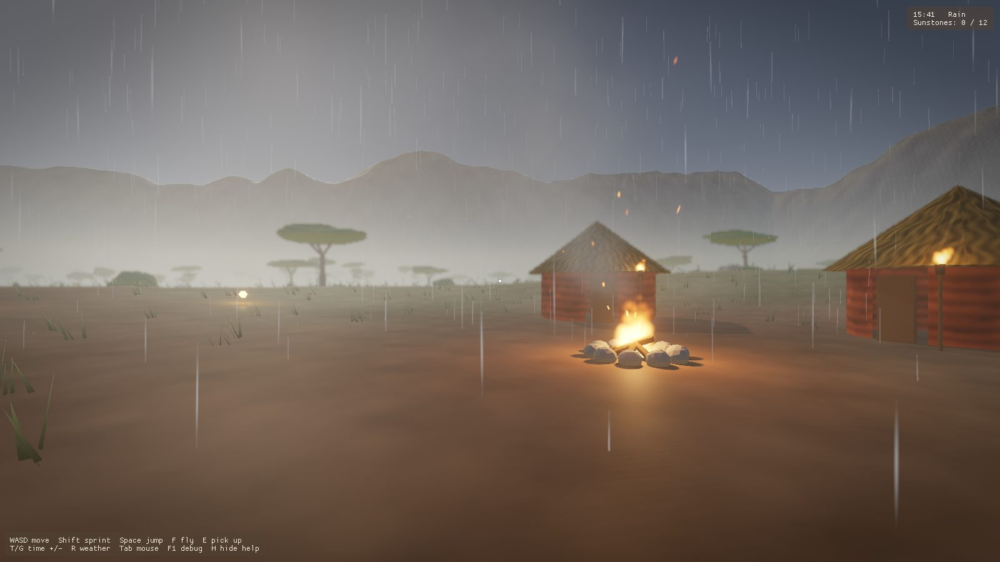
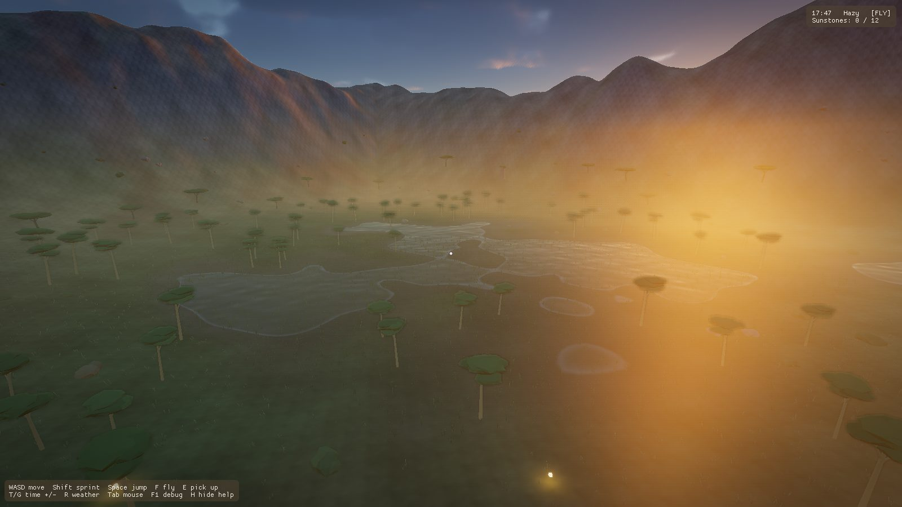
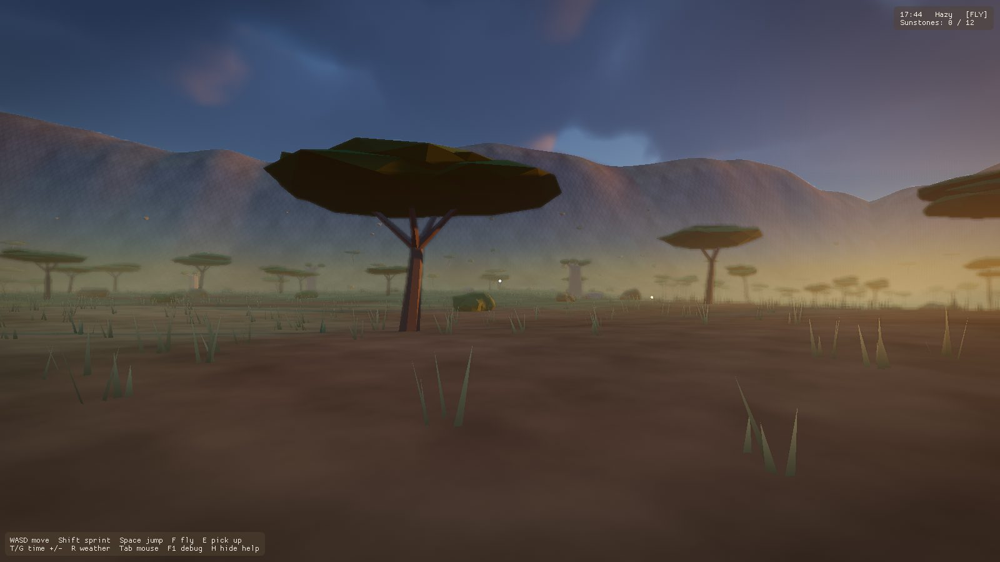

# Planning & Design Docs

This folder holds everything needed to understand, build and continue the
engine. It is written so a person **or an AI coding agent** can pick up the
project cold and keep going.

| File | Purpose |
|---|---|
| [00-vision.md](00-vision.md) | What we're building and why: goals, non-goals, target aesthetic |
| [01-architecture.md](01-architecture.md) | How the engine is structured: modules, frame flow, GPU data model, render graph |
| [02-roadmap.md](02-roadmap.md) | Phased plan with checklists and acceptance criteria (**the source of truth for progress**) |
| [03-conventions.md](03-conventions.md) | Coding conventions + "how do I..." recipes (add a pass, material, component, asset) |
| [04-agent-handoff.md](04-agent-handoff.md) | Instructions for an agent executing the roadmap: workflow, verification, gotchas |
| [decisions.md](decisions.md) | Architecture decision log: what was chosen, alternatives, and why |

## Quick start

```bash
cmake -S . -B build -G Ninja        # Debug, validation layers on
cmake --build build
./build/bin/savanna                 # the test scene
```

Controls are listed in the sandbox README section of [00-vision.md](00-vision.md#test-scene-savanna).

## Reference screenshots

`screenshots/` shows what the test scene should look like (Iris Xe, 1600×900).
Use them to spot visual regressions:

| | |
|---|---|
|  Camp at sunset, F1 overlay with per-pass GPU timings |  Kopje at dusk: CSM shadows, low-poly boulders |
|  Night: campfire/torch point-light shadows, smoke |  Rain: wet ground, overcast sky, rain streaks |
|  Swamp: water shader, fog glow towards the sun |  Acacias and baobabs |
